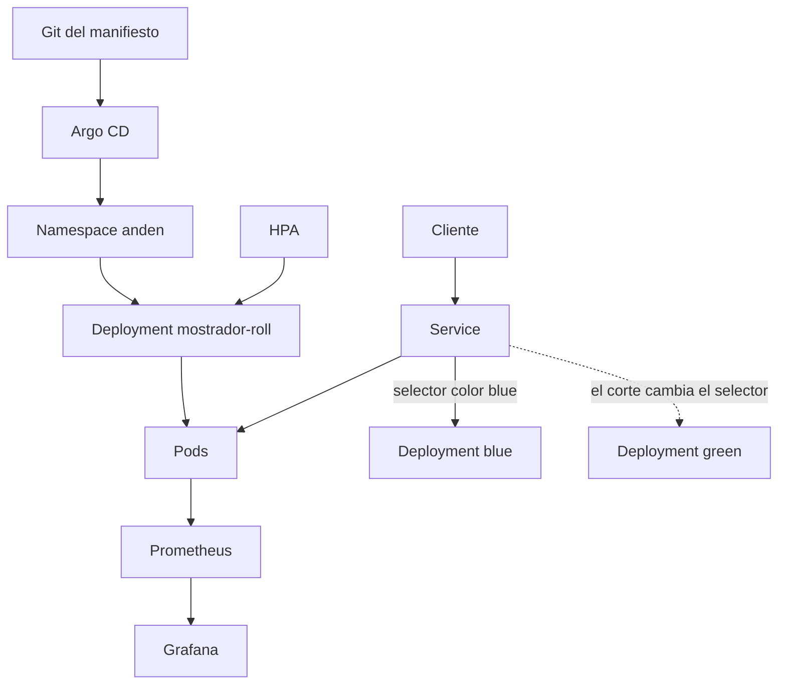

# Plataforma

El mapa de un clúster en Amazon EKS: desde el Pod hasta un corte azul-verde, con el paquete Helm y el sincronizado de Argo CD.

## Concepto

Cada tema del temario es un archivo que se puede leer y validar sin crear el clúster. Un EKS real cobra por el control plane y por los nodos, así que aquí no se aplica nada. `kubeconform` revisa los recursos nativos. El Service del mostrador apunta a `color: blue`; pasar a verde es cambiar ese selector.

## Stack

| Pieza | Para qué |
| --- | --- |
| Amazon EKS y eksctl | `eks/cluster.yaml`, con OIDC y el addon de EBS. |
| kubectl | Aplicar, ver el rollout y deshacerlo. |
| YAML | Pods, Services, workloads y almacenamiento. |
| ClusterIP, NodePort, LoadBalancer | `manifests/03-services.yaml`. |
| Namespaces, labels y selectors | `anden` y el `selector` de cada workload. |
| ReplicaSet y Deployment | `04-replicaset.yaml` y `05-deployment.yaml`, con rolling update. |
| Sidecar | `06-sidecar.yaml`, puesto y recolector. |
| DaemonSet y StatefulSet | `07-daemonset.yaml` y `08-statefulset.yaml`. |
| PV, PVC y EBS | `09-storage.yaml`, StorageClass `ebs-gp3`. |
| ConfigMap, Secret y env | `01-config.yaml` y el Pod `puesto`. |
| HPA y ResourceQuota | `10-escala.yaml`. |
| Job y CronJob | `11-jobs.yaml`. |
| Helm | Chart `helm/anden`. |
| Argo CD | `gitops/application.yaml`. |
| Prometheus y Grafana | `observability/prometheus-grafana.yaml`. |
| Blue-green | `blue-green/mostrador.yaml`. |

## Flujo



## Mapa

| Tema | Dónde |
| --- | --- |
| Cluster EKS | `eks/cluster.yaml` |
| Pods y Services | `manifests/02-pod.yaml`, `manifests/03-services.yaml` |
| ReplicaSet, Deployment y rolling update | `manifests/04-replicaset.yaml`, `manifests/05-deployment.yaml` |
| Sidecar, DaemonSet y StatefulSet | `manifests/06-sidecar.yaml`, `07-daemonset.yaml`, `08-statefulset.yaml` |
| PV, PVC y EBS | `manifests/09-storage.yaml` |
| ConfigMap, Secret y HPA | `manifests/01-config.yaml`, `manifests/10-escala.yaml` |
| Job y CronJob | `manifests/11-jobs.yaml` |
| Helm, Argo CD, observabilidad y blue-green | `helm/anden`, `gitops/application.yaml`, `observability/`, `blue-green/` |

## Correr

Desde esta carpeta, sin clúster:

```bash
kubeconform -summary -kubernetes-version 1.32.0 -ignore-missing-schemas \
  manifests blue-green observability gitops
helm lint helm/anden
helm template mostrador helm/anden | kubeconform -summary -kubernetes-version 1.32.0
```

`gitops/application.yaml` es un recurso de Argo CD. kubeconform lo deja pasar con `-ignore-missing-schemas`.

Con cuenta de AWS, y sabiendo que los nodos se facturan:

```bash
eksctl create cluster -f eks/cluster.yaml
kubectl apply -f manifests
kubectl -n anden rollout status deploy/mostrador-roll
kubectl -n anden rollout undo deploy/mostrador-roll
kubectl -n anden patch svc mostrador --type merge -p '{"spec":{"selector":{"color":"green"}}}'
eksctl delete cluster -f eks/cluster.yaml
```
